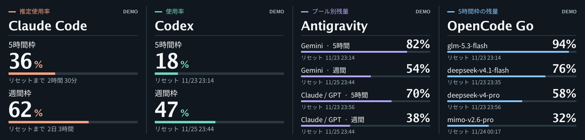

# quota-panel

[](https://github.com/tmr-br/quota-panel/actions/workflows/ci.yml)

Thermalright Trofeo Vision 9.16 インチ用の利用枠ダッシュボード。macOS と Linux で動く Go の単一実行ファイルです。Claude Code、Codex、Antigravity、OpenCode Go の残量・使用率を既定で 5 分ごとに取得します。USB パネル、ローカルのブラウザ、端末で利用できます。



## パネルなしで試す

配布アーカイブを展開するか、ソースからビルドした後に実行します。

```sh
./trofeo-quota -demo -web 127.0.0.1:9080
```

ブラウザで [ローカルダッシュボード](http://127.0.0.1:9080/) を開きます。デモはサンプル値を表示します。実データだけを PC 上で見るには `./trofeo-quota -headless -web 127.0.0.1:9080`、パネルとブラウザに同時に出すには `./trofeo-quota -web 127.0.0.1:9080` で起動します。終了は Ctrl+C です。

## 実機で最初の 1 枚を表示

リポジトリをクローンした場合は、先に Go で実行ファイルをビルドします。[ビルド手順](#設定変更とビルド)

1. パネルを接続したコンピューターで trcc を起動します。下記の API と画像保持の動作は **trcc-linux v9.12.2** の実装で確認しました。macOS 用 DMG では `trcc` の代わりに `/Applications/TRCC.app/Contents/MacOS/TRCC` を使えます。[trcc の導入手順](https://github.com/Lexonight1/thermalright-trcc-linux/blob/v9.12.2/doc/GUIDE_INSTALL.md#macos-experimental)

   ```sh
   trcc api --port 9876
   ```

2. 実行ファイルのあるディレクトリで次のコマンドを実行します。`-doctor` は OS から見える USB ID、trcc が認識した機器、カタログ寸法、接続済み機器のハンドシェイク寸法、ログの場所、`agy --version` を報告します。初回接続前はハンドシェイク寸法が不明なことがあります。`-demo` は必要に応じて trcc に接続を依頼し、実寸大の静止画を 1 枚送ります。画面内の **DEMO** が点灯確認の目印です。

   ```sh
   ./trofeo-quota -doctor
   ./trofeo-quota -demo
   ```

3. 同梱の `trofeo.toml` を編集して常駐モードを起動します。終了は Ctrl+C です。

   ```sh
   ./trofeo-quota -config ./trofeo.toml
   ```

| 実行例 | 動作 |
| --- | --- |
| `./trofeo-quota -demo -preview demo.png` | ダミー値の PNG を保存 |
| `./trofeo-quota -preview quota.png` | 実データの PNG を保存。取得できない行も確認可能 |
| `./trofeo-quota -once` | 実データの画像を 1 回送信 |
| `./trofeo-quota` | カレントディレクトリの `trofeo.toml` で常駐。ファイルがなければ内蔵既定値を使用 |
| `./trofeo-quota -status text` | USB にアクセスせず使用率・残量・リセット時刻を表示 |
| `./trofeo-quota -status json` | 1 回の取得結果を JSON で出力。未知の割合は `null`、実測ゼロは `0` |
| `./trofeo-quota -status prometheus` | Prometheus のテキスト形式で出力 |
| `./trofeo-quota -demo -preview demo.png -preview-size 1920x462` | 明示した寸法で、完全にオフラインの画像を生成。`-page 2` で複数ページの列の2ページ目を選択可能 |
| `./trofeo-quota -init-config local.toml` | 新規設定を生成。既存ファイルは保護。`-init-config -` は標準出力 |
| `./trofeo-quota -config local.toml -check-config` | 設定キー・値・タイムゾーンを検証 |
| `./trofeo-quota -version` | ビルドのバージョンまたはコミットを表示 |

## ブラウザ・自動監視

ローカル HTTP サーバーは `-web` を指定したときだけ起動します。ループバックで読み取り専用、ブラウザからの再読み込みは最後に取得した値を使います。モデル名・利用枠を同じホストの利用者に公開するため、共有マシンでは用途に合わせて有効にしてください。

| パス | 内容 |
| --- | --- |
| `/` | 設定順に並ぶ利用枠。使用率と残量、推定、取得不能、リセット日時を表示 |
| `/api/status` | バージョン付き JSON。取得時刻は UTC、各行に使用／残量の方向、推定フラグ、既知の期限 |
| `/metrics` | `quota_panel_available`、`_percent`、`_estimated`、`_reset_timestamp_seconds` 等。欠測時に割合系列は出力しません |
| `/healthz` | 最初の取得まで 503。その後は取得できた行数と全行数を返します。パネルの点灯状態は対象外です |
| `/panel.png?page=1` | 9.16 インチのカタログ寸法で、指定ページを PNG として表示 |

## 履歴・しきい値通知

TOML の既存の節を次のように編集します。履歴と通知は独立して有効にできます。

```toml
[insights]
history_dir = "~/.local/share/quota-panel"
retention_days = 7
alert_remaining_percent = 15
```

常駐中、取得サイクルごとに設定した項目の割合・時刻・推定区分をローカルに記録します。取得不能は欠測として記録し、デモは保存しません。保存先は `history_dir/quota-panel-v1/`、ファイルは所有者専用です。保持期間は UTC の日付単位で 1～90 日、サイズ上限は 1 日に 4 MiB のファイル 2 本です。高頻度設定では同じ日の古い記録から入れ替わります。保持期間を過ぎた記録は次回書き込み時に整理します。

CSV は表計算ソフト向けに、`@shared` 等の数式として扱われ得るキーの先頭にアポストロフィを付けます。JSON / JSONL は元のキーを保持します。`-trend-days` は保存期間内の記録を使い、最終観測、実測／推定ごとの残量の最小・最大、欠測件数を集計します。

通知は標準エラーに出ます。残量がしきい値以下になったときと、その後に回復したときに各1回記録します。Claude Code・Codex の使用率は残量に換算します。取得不能な間は直前の通知状態を保ちます。

```sh
./trofeo-quota -config local.toml -history csv > quotas.csv
./trofeo-quota -config local.toml -history json > quotas.json
./trofeo-quota -config local.toml -history jsonl > quotas.jsonl
./trofeo-quota -config local.toml -trend-days 7
```

## パネル表示の設定

```toml
[display]
timezone = "Asia/Tokyo"
high_contrast = true
rotate_180 = false
page_seconds = 12
```

高コントラストと 180 度回転はパネル画像に適用します。`timezone` はパネル・ブラウザの時刻表記に使います。5 行以上の列は 4 行ずつページを送り、`page_seconds` が正なら取得と独立して切り替えます。既定の 0 では取得サイクルに合わせます。

## パネルの寸法と送信経路

trcc のレジストリでは `0416:5408` と `0416:5409` の両方が **1920×462** の LY 系です。`5408` の利用者は 462 行と 480 行でテストカードを比較し、462 行で四辺が正しく表示されることを確認しています。6.86 インチなどで使われる HID の `0416:5302` は選択対象外です。[デバイス表](https://github.com/Lexonight1/thermalright-trcc-linux/blob/v9.12.2/doc/REFERENCE_DEVICES.md) · [レジストリ](https://github.com/Lexonight1/thermalright-trcc-linux/blob/v9.12.2/src/trcc/core/registry.py) · [実機での比較](https://github.com/Lexonight1/thermalright-trcc-linux/issues/248#issuecomment-6670753448)

送信時は `GET /devices` で対象を選び、`GET /devices/{key}/state` の接続状態、実機名、LY ハンドシェイクの PM/SUB、`resolution` を読みます。9.16 と 11.3 は ID を共有するため、9.16 に対応するハンドシェイクを確認してから送信します。未同定の場合も送信を保留します。その幅と高さで文字とバーを直接描画し、`POST /devices/{key}/display/send-image` の multipart フィールド `image` に PNG を渡します。実寸が読めないときは接続を再確認します。プレビューでは実機、trcc のカタログ、内蔵カタログの順で寸法を選び、採用した根拠を標準エラーに出力します。[REST API](https://github.com/Lexonight1/thermalright-trcc-linux/blob/v9.12.2/doc/REFERENCE_API.md)

LY パネルには直前のフレームを定期的に再転送する必要があります。trcc がその USB 転送を担当するため、表示中は trcc を起動しておいてください。Go 側は PNG の SHA-256 と送信先を、trcc が成功を返した時点で記憶します。10 秒ごとの接続確認と、対応版では `/events` の着脱通知で復帰を検出し、その時点の画像を再送します。trcc の終了、機器の着脱、送信拒否、取得失敗は個別に扱います。[LY の keepalive](https://github.com/Lexonight1/thermalright-trcc-linux/blob/v9.12.2/src/trcc/adapters/device/ly_lcd.py) · [trcc の SendImage](https://github.com/Lexonight1/thermalright-trcc-linux/blob/v9.12.2/src/trcc/core/commands/device.py)

### macOS で REST 送信を切り分ける

この開発環境は USB パススルーのない Linux です。trcc 9.12.2 の配布版 REST ハンドラと仮想デバイスを組み合わせ、Go バイナリから送った 1920×462 PNG が trcc の `SendImage` に届くところまで確認しました。macOS と LY 実機での点灯確認は未実施です。trcc 自身も macOS 対応を experimental としています。REST が失敗する場合や、受理されても画面に出ない場合は、保存した PNG を trcc の CLI から送ると、問題が REST 経路に限られるかを確認できます。

```sh
./trofeo-quota -demo -preview demo.png
trcc display send-image 0416:5408 demo.png
```

`5409` または `@port` 付きの機器では `-doctor` が表示したキーを使います。CLI でも表示されない場合は `trcc report` でハンドシェイクと転送エラーを確認できます。[CLI リファレンス](https://github.com/Lexonight1/thermalright-trcc-linux/blob/v9.12.2/doc/REFERENCE_CLI.md)

## データの読み方

| 列 | 表示値と取得元 |
| --- | --- |
| Claude Code | ローカルログから計算した **推定使用率**。5 時間枠・週間枠のリセットまでの残り時間を表示 |
| Codex | セッションログに記録された **使用率**。primary と secondary の期間・リセット日時を表示 |
| Antigravity | Gemini と Claude/GPT のプールごとの **残量**。5 時間枠・週間枠を独立して表示 |
| OpenCode Go | 設定したモデルに帰属する **5 時間枠の残量**。共通枠用の行も選択可能 |

数値の欠落、期限切れ、コマンド失敗、読めないログ、曖昧なアカウントは該当行を **取得不能** にします。計測できた 0% は 0% と表示します。取得に失敗した理由は標準エラーに記録します。表示時刻の既定値はコンピューターのローカル時刻です。

### Claude Code

`~/.claude/projects/**/*.jsonl` を再帰的に読み、assistant の入力・出力・キャッシュ作成・キャッシュ読み込みトークンを数えます。サブエージェントの progress 記録と advisor の追加消費も対象です。リクエスト ID、メッセージ ID、親子 UUID を使って複製をまとめ、時刻順に ccusage 方式の 5 時間ブロックを組み立てます。開始は最初の利用時刻を UTC の正時に切り下げます。週は設定したリセット基準から 7 日単位で区切ります。[ccusage のブロックと上限](https://github.com/ryoppippi/ccusage/blob/main/docs/guide/blocks-reports.md)

セッションのトークン数だけでは Anthropic の契約上の正確な利用率を復元できません。`[claude]` の `five_hour_tokens` と `weekly_tokens` に自分のトークン予算を、`weekly_reset_anchor` に契約画面で確認した週リセットの日時を設定します。上限を未設定にした枠は「取得不能」です。他のマシンや削除済みログでの利用はこの推定に含まれません。入力例は `trofeo.toml` にあります。

### Codex

`~/.codex/sessions/` 配下の JSONL の `event_msg → token_count → rate_limits` を読み、イベント時刻が最新の通常 Codex 枠を採用します。`used_percent` は使用率、`resets_at` は Unix 秒です。別枠の `limit_id` は混在させません。期限を過ぎた窓は、新しい記録を取得するまで「取得不能」です。[Codex のデータ型](https://github.com/openai/codex/blob/main/codex-rs/protocol/src/protocol.rs)

### Antigravity

毎回、同じ `agy` 実行ファイルに対して `--version` を先に実行します。**1.1.11 以上と確定した場合だけ** `agy -p /usage --output-format json` を呼びます。1.1.11 で追加された読み取り専用の print-mode 動作は Google のリリースノートに明記されています。JSON の `command.data.groups[].buckets[]` から、対象バケットの `remaining_fraction` と `reset_time` を読みます。[Google の v1.1.11 リリース](https://antigravity.google/releases?tab=cli&version=1.1.11) · [モデル枠の説明](https://antigravity.google/docs/cli/commands/usage)

旧版、未導入、バージョン不明の場合は、同じ OS ユーザーで起動中の Antigravity language server を探し、対象プロセスが所有するループバックの待ち受けを照合して Connect-RPC を送ります。動的ポートでは既知の API を識別してから必要に応じて CSRF を使います。実行中の `agy` 自身が提供する無認証 RPC も、現在インストールされた実行ファイルと一致する単一候補で利用できます。`RetrieveUserQuotaSummary` を優先し、不足する場合は同じ接続先の `GetUserStatus` を照会します。期間を区別できない旧応答、照合できない待ち受け、複数候補でアカウントが曖昧な環境、停止中のサーバーは該当行が「取得不能」です。プロセス引数やトークンは表示・保存しません。[ローカル API の参考実装](https://github.com/steipete/CodexBar/blob/main/Sources/CodexBarCore/Providers/Antigravity/AntigravityStatusProbe.swift)

### OpenCode Go

`npx --yes @slkiser/opencode-quota@latest show --json` の公開 JSON v3 を読みます。通常は `--provider opencode-go` で絞り込みます。この CLI は OpenCode が最後に保存したクォータを返すため、OpenCode 側でプラグインのセットアップとログインが必要です。

調査した 6.3.0 の標準プロバイダーはアカウント共通の 5 時間・週・月の行を出力します。**標準出力だけから 4 モデルそれぞれの残量は計算できません。** モデル別の 5 時間行がない場合は「取得不能」です。`models = ["@shared"]` にすると実在する共通 5 時間枠を表示できます。モデル専用の 5 時間行をプラグインにカスタム登録済みの場合は `[opencode.model_rows]` で各モデルに異なる公開行 ID を割り当てられます。デモのモデル別数値は画面確認用です。[公開 JSON 形式](https://github.com/slkiser/opencode-quota/blob/main/docs/readme/external-integration.md) · [OpenCode Go プロバイダー](https://github.com/slkiser/opencode-quota/blob/main/src/providers/opencode-go.ts)

OpenCode の標準行は、複数ログイン時に `[opencode]` の `account` で公開 JSON のアカウント名を指定できます。標準プロバイダーの部分応答はアカウントごとの鮮度が確定できないため「取得不能」です。カスタム行のローカル推定は「推定」と表示します。上限超過の負の残量も表示し、リセット不明の行は取得から 5 時間で失効します。

## 自動起動

既存の設定ファイルを指定すると、実行ファイルの位置に合わせたユーザー用サービス定義を標準出力に生成できます。

```sh
./trofeo-quota -config ./local.toml -service systemd > quota-panel.service
./trofeo-quota -config ./local.toml -service launchd > quota-panel.plist
```

Linux はユーザー用 systemd、macOS はログインユーザー用 LaunchAgent の定義です。インストールや起動は OS のサービス管理で行います。普段アプリを起動する常設ディレクトリから生成してください。設定済みの `CODEX_HOME`・`CLAUDE_CONFIG_DIR` は絶対パスにして引き継ぎます。サービスは生成時の作業ディレクトリと絶対 `PATH` を取り込むため、`npx` と `agy` を使えるシェルで生成し、インストール先が変わったら再生成してください。

## 設定変更とビルド

`display_order` で列の選択と順番、各節の `enabled` で取得の有無、`items` または `models` で行の選択と順番を指定します。列ごとに最大 4 行を表示し、5 行以上は取得サイクルごとにページを切り替えます。`interval_seconds` と `trcc_url` も含めてサイクルごとに読み直します。編集中の TOML に誤りがある場合は最後に読めた設定で動作を続けます。ログのルートは TOML と環境変数 `CLAUDE_CONFIG_DIR`、`CODEX_HOME` に対応します。

Actions の **Build binaries** は手動実行または `v*` タグで Linux・macOS の amd64 / arm64 用アーカイブと `SHA256SUMS` を生成します。展開したアーティファクトで `shasum -a 256 -c SHA256SUMS` を実行できます。[配布ワークフロー](https://github.com/tmr-br/quota-panel/actions/workflows/binaries.yml)

ソースからのビルドには Go 1.23 以降を使います。macOS 26 向けの実行ファイルは Mach-O UUID が標準で付く Go 1.24 以降でビルドしてください。日本語フォントはバイナリに埋め込んであります。実行にはパネル制御用の trcc と、有効にしたソースで利用する外部コマンドが必要です。

```sh
CGO_ENABLED=0 go test ./...
CGO_ENABLED=0 go build -trimpath -o trofeo-quota .
```

テストはハンドシェイク寸法に一致する PNG、HTTP の受理・再送、設定の再読み込み、ログの重複・欠損、実測 0% と取得不能、旧版 agy の起動引数、ローカル RPC を検証します。

## ライセンス

quota-panel 本体は MIT License で公開しています。[LICENSE](LICENSE)

同梱のフォントと Go ライブラリには、それぞれのライセンスが適用されます。[第三者ライセンス一覧](THIRD_PARTY.txt) · [日本語フォントの SIL Open Font License](assets/OFL.txt)
